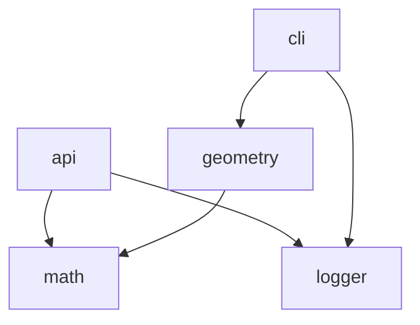

<p align="center"></p>

<div align="center">

# Go Nx Plugin — Playground

**A full overview of what [nx-go](https://github.com/nx-go/nx-go) can do for you!**

✨ This workspace has been generated by [Nx, Smart Monorepos · Fast Builds](https://nx.dev) ✨

</div>

---

## Project graph

Run `pnpm nx graph` to explore the workspace project graph and the tasks you can run with Nx.



[Learn more about Exploring the Project Graph](https://nx.dev/docs/features/explore-graph)

## Generate code

Nx plugins can provide generators for creating or updating projects and code.

Run `pnpm nx list` to see the installed plugins, then `pnpm nx list <plugin-name>` to see a plugin's generators. To inspect the tasks Nx detects for a project, run `pnpm nx show project <project-name>`.

Learn more about [Nx generators on the docs](https://nx.dev/docs/features/generate-code).

## Running tasks

Run a target for one project:

```sh
pnpm nx run <project-name>:<target>
```

Run one or more targets across all projects that define them:

```sh
pnpm nx run-many -t build test
```

Add `-p` to restrict the run to specific projects:

```sh
pnpm nx run-many -t build test -p api cli
```

For CI or local changes, run targets only for affected projects. This workspace sets `main` as the default base branch:

```sh
pnpm nx affected -t lint test
```

Nx discovers tasks from the Nx Go plugin and project configuration; tasks can also be defined in `package.json` scripts or `project.json` files. Learn more about [running tasks](https://nx.dev/docs/features/run-tasks) and [affected projects](https://nx.dev/docs/features/ci-features/affected).
